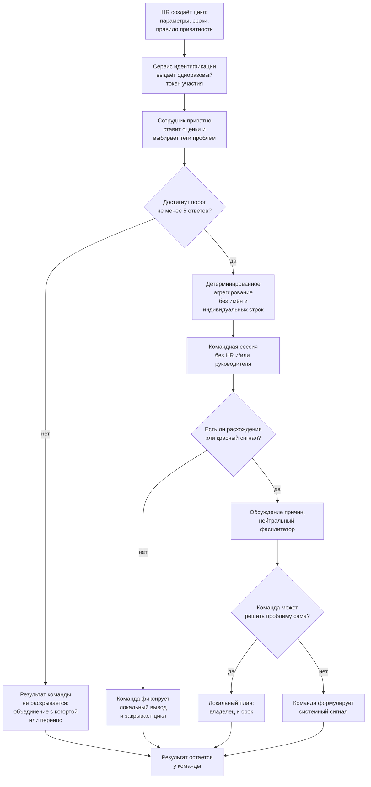
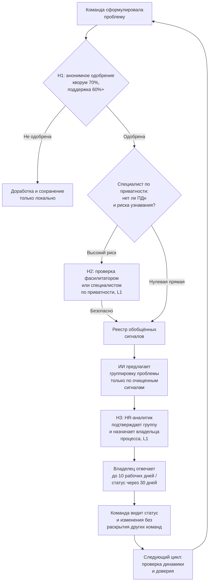
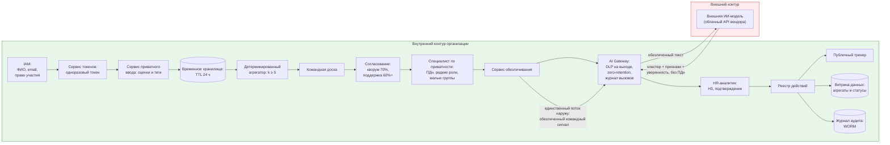

# Целевой процесс и архитектура решения

## Целевой процесс

### Командная сессия и сбор данных



### Передача данных HR и работа с данными




## Обоснование альтернатив

<!-- ЗАПОЛНИТЕ: рассмотрены варианты, выбран один, выбор обоснован -->

| Вариант | Описание | Почему не выбран | Почему выбран |
|---|---|---|---|
| Обычный опрос HR | Индивидуальная анкета и централизованный анализ | Усиливает страх идентификации, особенно в малых командах  |  |
| Полностью открытый ретро-разбор | Вся команда обсуждает свои проблемы/пожелания с руководителем | Высокая конкретность, но максимальная социальная цена высказывания |  |
| Полностью автоматизированный сбор через ИИ-бота | Бот задает вопросы в чате и анализирует ответы | Не снижает воспринимаемый контроль; риск утечки данных, неверной интерпретации |  |
| Адаптированный Squad Health Check | Приватная оценка, командное обсуждение, наружу уходит только одобренный командой сигнал |  | Снижает страх за счет отсутствия HR на встрече, и передачи только системных сигналов; ИИ (при налиии) обрабатывает обезличенные данные, не усиливая контроль; человек подтверждает выводы |

**Почему здесь нужен ИИ, а не детерминированное правило?**

Для ядра процесса ИИ не нужен. Проверка порога ответов, расчет распределений, подавление малых групп, маршрутизация и сроки реализуются детерминированными правилами. Это повышает проверяемость и снижает риск.

ИИ оправдан только в узкой задаче после обезличивания: команды могут описывать одну системную проблему разными словами, например "много срочных задач", "постоянные переработки" и "нет возможности планировать". Семантическая модель предлагает общий тематический кластер и черновик краткой сводки по нескольким командам. Окончательное решение о смысле сигнала, его приоритете и владельце принимает человек.

Если пилот показывает небольшой объем сигналов, ИИ отключается, а классификация выполняется HR аналитиком самостоятельно. 
Архитектура не зависит от наличия модели

## Архитектура решения

| Компонент | Назначение | Ответственность |
|---|---|---|
| Оркестратор циклов | Создание цикла, параметры, сроки, напоминания | Отвечает за корректность расписания цикла и неизменность параметров в течение сессии. Не хранит ответы, оценки и тексты сигналов; не имеет доступа к индивидуальным записям. Перед стартом цикла фиксирует версию правил приватности, которая будет действовать до закрытия |
| Сервис идентификации и токенов | Проверка права участия и выдача одноразового токена | Отвечает за то, чтобы участвовал только сотрудник с правом участия, и за то, чтобы токен был одноразовым и не содержал ФИО, email или табельного номера. Знает сотрудника, но не знает его оценок. Обеспечивает ротацию ключей и невозможность повторного использования токена |
| Сервис приватного ввода | Прием оценок и тегов по токену | Отвечает за то, чтобы оценки и теги принимались без привязки к личности: не запрашивает ФИО, email, табельный номер и т д . Валидирует формат ввода и передает записи в хранилище в зашифрованном виде. Не формирует свободный текст — только оценки и выбор из справочника тегов. |
| Операционное хранилище ответов | Временное хранение зашифрованных индивидуальных записей | Отвечает за срок жизни данных: TTL 24 часа после агрегирования, затем необратимое удаление. Обеспечивает шифрование с раздельными ключами и запрет выгрузки. Не строит профили и не отдает записи поштучно — только агрегатору для расчета распределений |
| Защита конфиденциальности | Проверка минимального размера группы, ПДн, редких сочетаний и текста | Отвечает за блокировку публикации любого среза, где возможна идентификация: k < 5, упоминание ФИО, редкой роли, названия малой команды или уникальной детали. Работает до регистрации сигнала в реестре. Имеет право запретить публикацию и вернуть сигнал на правку. Не оценивает смысл сигнала и не принимает решений о его приоритете. |
| Детерминированный агрегатор | Расчет распределений оценок и динамики по параметрам | Отвечает за воспроизводимость и проверяемость расчетов: одинаковые входные данные дают одинаковый результат. Работает только с порогом k ≥ 5. Не строит индивидуальные профили, не сравнивает сотрудников между собой, не передает результаты дальше командной доски. |
| Командная доска | Отображение агрегатов и расхождений на сессии | Отвечает за то, чтобы команда видела только распределения (например, "3 зеленых, 2 желтых, 1 красный"), а не индивидуальные строки. Позволяет открыть расхождения для обсуждения, но не позволяет идентифицировать автора оценки. Доступ только у команды и фасилитатора |
| Рабочее место фасилитатора | Ведение сессии и помощь в формулировке общего сигнала | Отвечает за процесс обсуждения: помогает команде пройти по параметрам, зафиксировать разногласия и сформулировать системный сигнал. Не имеет доступа к сырым ответам, не видит индивидуальных оценок, не может опубликовать сигнал вместо команды. Фиксирует только итоговую формулировку |
| Сервис командного согласования | Анонимная фиксация кворума и поддержки формулировки | Отвечает за легитимность сигнала: проверяет, что кворум ≥ 70% и поддержка ≥ 60%+, фиксирует результат голосования без персональной истории. Не показывает, кто голосовал "за" или "против", не хранит связь между сотрудником и его голосом после закрытия сессии |
| Реестр системных сигналов | Хранение одобренных формулировок, владельца, срока и статуса | Отвечает за прослеживаемость сигнала: у каждой записи есть текст, владелец, срок и текущий статус. Не хранит автора, сырые ответы и индивидуальные оценки. Служит единым источником правды для публичного трекера и аудита. |
| Сервис обезличивания | Удаление имен, контактов, редких ролей и названий малых команд | Отвечает за подготовку текста к передаче в модель: очищает сигнал от всего, что может указывать на личность или малую группу. Работает до передачи в сервис тематической группировки. Если после очистки сигнал теряет смысл — возвращает на доработку. |
| Сервис тематической группировки (ИИ) | Предложение кластера и черновика сводки по очищенным сигналам | Отвечает за предложение, а не за решение: формирует кластер, черновик сводки и оценку уверенности на основе только очищенных текстов. Не публикует, не назначает владельца, не определяет приоритет, не имеет инструментов и не обучается на данных пилота. При малом объеме сигналов отключается. |
| Рабочее место HR-аналитика | Подтверждение кластера и назначение владельца процесса | Отвечает за содержательное решение: подтверждает, редактирует или отклоняет предложение модели с обязательной причиной; назначает владельца процесса. Не имеет доступа к индивидуальным ответам и не может раскрыть связь "сотрудник - сигнал" |
| Публичный трекер действий | Отображение статуса сигнала: "Принято", "В работе" и тд| Отвечает за замыкание обратной связи: команда видит, что произошло с ее сигналом, без раскрытия данных других команд. Статус обновляется владельцем в срок; просрочка автоматически эскалируется. Не показывает внутреннюю переписку и детали, которые могут раскрыть автора |
| Журнал решений и аудит | Фиксация версий, действий, сроков, отмен и эскалаций | Отвечает за доказуемость: можно восстановить, по каким обезличенным данным принималось решение, не создавая связи "сотрудник - мнение". Доступ только у аудитора; псевдонимы раскрываются лишь при расследовании доступа. |

## Границы контура данных



| Данные | Где хранится | Что уходит наружу | Чем защищено |
|---|---|---|---|
| Обезличенная проблема | Формируется в сервисе обезличивания, передаётся через AI Gateway во внешний API | Только очищенный текст: формулировка, одобренная командой, без имён, контактов, названий малых команд, индивидуальных ответов и метаданных сессии | Обезличивание до выхода, DLP на выходе, zero-retention |

## Human-in-the-Loop

### Уровни автоматизации

| Уровень | Что делает система | Где применять |
|---|---|---|
| L0 | человек делает всё, система хранит | Живое обсуждение причин и выбор локальных действий |
| L1 | система готовит сводку, человек решает | H1–H5: публикация сигнала, privacy-review, подтверждение группы, назначение владельца, закрытие сигнала; H6: политика вызова внешней модели |
| L2 | система предлагает с обоснованием, человек подтверждает | Не используется в MVP |
| L3 | система действует сама ниже порога риска | Напоминания, расчёт агрегатов, подавление малой группы, удаление по TTL, автоматическая эскалация просрочки, DLP-проверка на выходе |
| L4 | система действует без участия человека | Не используется |

### Точки вмешательства

| ID | Точка решения | Уровень | Условие срабатывания | Право на отказ | Срок | Эскалация | Куда попадает лог |
|---|---|---|---|---|---|---|---|
| H1 | Передача проблемы за пределы команды | L1 | Команда признала проблему системной | Да, анонимное голосование; кворум 70%, поддержка 60%+ | Во время сессии | Повторная формулировка; критический случай в защищённый канал | consent_log, только агрегат голосования |
| H2 | Проверка риска идентификации | L1 | Найдено имя, роль, малая группа или уникальную деталь  | Да, проверяющий может запретить публикацию или вернуть на правку | 2 рабочих дня | Специалист по приватности | privacy_review_log |
| H3 | Подтверждение кластера внешней модели | L1 | Модель предложила объединить не менее трех командных проблем | Да, HR-аналитик подтверждает, редактирует или отклоняет с причиной | 3 рабочих дня | HR-аналитик | model_review_log |
| H4 | Назначение владельца и ответа | L1 | Группа проблем или отдельная проблема принята | Да, но отказ только с объяснением и новым маршрутом | Подтверждение до 10 рабочих дней | HR-аналитик/владелец процесса | action_log |
| H5 | Решение о закрытии проблемы | L1 | Владелец отметил действие выполненным | Команда может не согласиться анонимным голосованием | 30 дней или заявленный срок | Владелец процесса уровнем выше | closure_log |
| H6 | Вызов внешней модели | L1 | DLP на выходе не нашёл ПДн; объём сигналов выше порога; вендор подтвердил zero-retention | Да, специалист по приватности может отключить внешнюю модель для пилота | 2 рабочих дня на пересмотр политики | HR-директор/специалист по приватности | gateway_policy_log, dlp_outbound_log |

### Объяснимость

```text
Пример решения: внешняя модель предложила группу "Системная перегрузка и конфликт приоритетов". Уверенность: 0,78.
Повлиявшие признаки:
+ в 4 обезличенных проблемах повторяются темы "срочные задачи", "переработки", "смена приоритетов";
+ 3 проблемы отнесены к межфункциональному согласованию;
− в 2 проблемах также присутствует тема нехватки людей.
Использованные данные: только одобренные командами формулировки после обезличивания; индивидуальные оценки, имена и исходные комментарии в модель не передавались.
Почему уверенность не выше: часть формулировок может описывать нехватку ресурсов, а не конфликт приоритетов.
Что проверить человеку: действительно ли у проблем общий владелец процесса; не потеряется ли отдельная проблема нехватки людей; достаточно ли агрегирован срез для защиты команд.
Рекомендация: объединить в одну группу только после подтверждения HR-аналитиком.
```

### Поведение при недоступности внешней модели
- AI Gateway возвращает ошибку, вызов не выполняется;
- HR-аналитик получает уведомление и переходит в ручной режим кластеризации по справочнику тем;
- Сигналы не теряются: они остаются в реестре и обрабатываются в порядке поступления;
- В model_review_log фиксируется причина ручной обработки (gateway_unavailable);
- После восстановления API ручная кластеризация не пересматривается автоматически — она уже подтверждена человеком (H3)

### Право на отказ и эскалация

| Точка | Может ли человек отклонить | Что происходит при отказе | Что если не ответил |
|---|---|---|---|
| H1 — передача сигнала за пределы команды | Да | Сигнал остается внутри команды; фиксируется в consent_log как "Не одобрен" | Сессия закрывается без передачи; сигнал не считается переданным; повторная формулировка возможна на следующем цикле |
| H2 — проверка риска идентификации | Да | Сигнал не регистрируется в реестре; возвращается команде с указанием причины; в privacy_review_log фиксируется rejected и обоснование | Через 2 рабочих дня — эскалация к специалист по приватности; до решения сигнал блокирован; если специалист по приватности не ответил за 4 рабочих дня — сигнал отклоняется по умолчанию с уведомлением команды |
| H3 — подтверждение кластера внешней модели | Да | Кластер не создаётся; сигналы остаются раздельными; в model_review_log фиксируется rejected, причина и model_version; при отключённой модели — ручная кластеризация | Через 3 рабочих дня — эскалация к руководителю HR-аналитики; сигналы не теряются, остаются в реестре в статусе "Ожидает решения" |
| H4 — назначение владельца и ответа | Да | Сигнал переназначается другому владельцу или возвращается HR-аналитику с указанием причины; в action_log фиксируется reassigned и новый маршрут | Подтверждение до 10 рабочих дней; при отсутствии ответа — автоматическая эскалация к HR-директору / владельцу процесса; сигнал остается в статусе "Просрочен" |
| H5 — решение о закрытии сигнала | Да | Сигнал переоткрывается; в closure_log фиксируется reopened и причина; владелец обязан ответить в новый срок | 30 дней или заявленный срок; при отсутствии статуса — эскалация к владельцу процесса уровнем выше; сигнал остается в статусе "просрочен", команда видит это в трекере |
| H6 — разрешение вызова внешней модели | Да | Вызовы блокируются; сигналы обрабатываются в ручном режиме по справочнику тем; в gateway_policy_log фиксируется disabled и причина | 2 рабочих дня на пересмотр политики; до решения вызовы блокируются; если специалист по приватности не ответил — действует предыдущая политика, а инцидент эскалируется к HR-директору |

## Риски ИИ и контрмеры

| Риск | Категория | Сценарий | Контрмера в архитектуре | Уровень контроля | Проверка |
|---|---|---|---|---|---|
| Трансграничная передача данных | право | Обезличенный текст уходит в зарубежный облачный API | Приоритет вендора с обработкой (152-ФЗ); уведомление о трансграничной передаче | H | Юридическая экспертиза; аудит маршрутов данных |
| Логи и хранение промптов у вендора | данные | Вендор хранит запросы дольше заявленного | Договор с фиксированным сроком хранения и удалением; регулярный аудит; запрет на чувствительные категории во входе | L + H | Аудит вендора; выборочная проверка выгрузок |
| Утечка через побочные каналы шлюза | данные / безопасность | Логи шлюза содержат текст сигнала дольше нужного | Шифрование логов, короткий TTL, доступ только аудитору; хеш вместо текста в журнале вызовов | L3 + H | Пентест шлюза; аудит логов |
| Недоступность внешнего API | надёжность | Модель недоступна — процесс останавливается | Автоматическое переключение на ручную кластеризацию по справочнику тем; SLA шлюза; очередь повторных вызовов | L3 + H | Учения по отказоустойчивости; мониторинг доступности |
| Ложное чувство безопасности из-за "облака" | прозрачность / влияние на людей | Команда считает, что раз данные обезличены, риск нулевой | Честное уведомление в интерфейсе: что уходит, куда и зачем; право команды отказаться от внешней обработки | H | Тест понимания перед участием |


## Принятые сознательно риски

| Риск | Причина принятия | Компенсация |
|---|---|---|
| Абсолютная неузнаваемость в маленькой команде недостижима | Полная анонимность в малой группе технически невозможна без потери полезности | Честное информирование, подавление срезов ниже порога, отдельный защищенный канал |
| Агрегирование уменьшает конкретность | Осознанная плата за безопасность | Конкретика восстанавливается в командной формулировке, а не в индивидуальном профиле |
| ИИ может ошибаться в группировке | Модель ничего не публикует и не назначает сама; её предложение обратимо | H3 с правом отклонить, признаки и уверенность, возможность разделить кластер |
| Внешняя модель видит обезличенный текст сигнала | Без этого невозможна семантическая кластеризация при большом объёме | Обезличивание до выхода, DLP, zero-retention, договор, право команды отказаться |
| Отказ команд от участия | Отказ — диагностический сигнал недоверия, а не сбой процесса | Мониторинг доли отказов, разбор причин |


## Логирование и аудит

```text
decision_id, timestamp, actor_role, actor_pseudonym, system_version,
policy_version, gateway_version, model_version, input_hash,
aggregate_size, privacy_threshold, features_used, model_output,
confidence, human_action, override_reason, escalation_state,
retention_until
```
