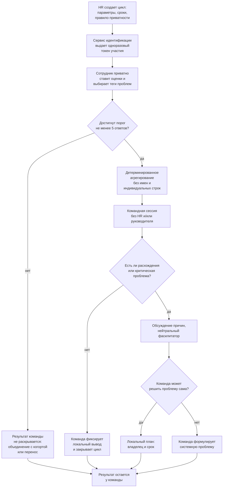
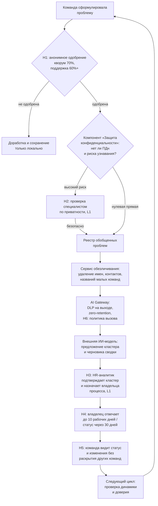
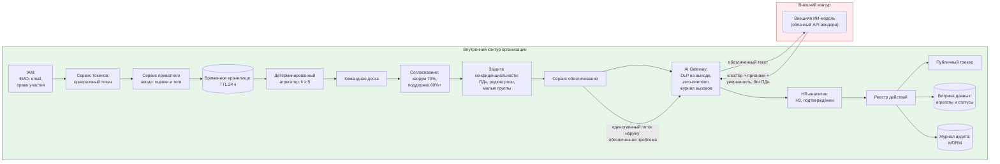

# Целевой процесс и архитектура решения

## Цель TO-BE

Повысить долю достоверной и пригодной для последующих действий обратной связи от сотрудников, сократив разрыв между официальными и неофициальными данными, не менее чем на 30% в течение 6 месяцев после пилота.

Ограничение: не допустить ухудшения психологической безопасности сотрудников и не превратить сбор обратной связи в инструмент контроля; не увеличить нагрузку на HR-специалистов; не ухудшить коэффициент отклика на существующие опросы.

## Метрики успеха пилота

| Метрика | Единица | Сейчас | Источник | Целевое значение |
|---|---|---|---|---|
| Доля сотрудников, верящих в анонимность | % | ≤ 30 | Sogolytics 2024 | ≥ 50 |
| Доля социально желательных ответов в exit-интервью | % | ≥ 50 | INTOO 2024 | ≤ 30 |
| Доля конкретных free-text комментариев к рейтинговым вопросам | % | ~6 | Culture Amp 2024 | ≥ 15 |
| Повторяемость одних и тех же проблем от опроса к опросу | % | ≥ 60 | City of Perth 2025 | ≤ 30 |
| Время от выявления проблемы до видимого изменения | месяцев | ≥ 6 | Happily.ai 2025 | ≤ 3 |

## Целевой процесс

### Командная сессия и сбор данных



**Важно:** руководитель не присутствует на командной сессии и не видит индивидуальные ответы. Это ключевое отличие от AS-IS, где руководитель получал срез команды и разбирал его с сотрудниками.

### Передача данных HR и работа с данными



### Сводка шагов процесса (нумерация для трассируемости)

| # | Шаг | Контур | Роль | Уровень |
|---|---|---|---|---|
| 1 | HR создает цикл: параметры, сроки, правило приватности | Организационный | HR | L3 |
| 2 | Сервис идентификации выдает одноразовые токены | Организационный | Сервис идентификации | L3 |
| 3 | Сотрудники приватно ставят оценки и выбирают теги | Командный | Сотрудник | L0 |
| 4 | Детерминированный агрегатор проверяет порог ≥ 5 и считает распределения | Организационный | Агрегатор | L3 |
| 5 | Команда проводит сессию с фасилитатором, обсуждает разногласия | Командный | Команда + фасилитатор | L0 |
| 6 | Команда формулирует системную проблему | Командный | Команда | L0 |
| 7 | H1: команда анонимно голосует; кворум ≥ 70%, поддержка ≥ 60%+ | Командный | Команда | L1 |
| 8 | H2: проверка риска идентификации специалистом по приватности | Организационный | Специалист по приватности | L1 |
| 9 | Проблема регистрируется в реестре, проходит обезличивание | Организационный | Сервис обезличивания | L3 |
| 10 | H6: AI Gateway проверяет политику и DLP, вызывает внешнюю модель | Организационный | AI Gateway | L1 (политика) + L3 (DLP) |
| 11 | H3: HR-аналитик подтверждает кластер, назначает владельца | Организационный | HR-аналитик | L1 |
| 12 | H4: владелец принимает проблему, обновляет статус | Организационный | Владелец процесса | L1 |
| 13 | H5: команда видит статус, при необходимости переоткрывает | Организационный | Команда + владелец | L1 |
| 14 | Следующий цикл: проверка динамики доверия | Организационный | HR + команда | L1 |

## Обоснование альтернатив

| Вариант | Описание | Почему не выбран | Почему выбран |
|---|---|---|---|
| Обычный опрос HR | Индивидуальная анкета и централизованный анализ | Усиливает страх идентификации, особенно в малых командах; не меняет владельца данных и не гарантирует видимых действий | — |
| Полностью открытый ретро-разбор | Вся команда обсуждает свои проблемы с руководителем | Высокая конкретность, но максимальная социальная цена высказывания; руководитель видит индивидуальные ответы | — |
| Полностью автоматизированный сбор через ИИ-бота | Бот задает вопросы в чате и анализирует ответы | Не снижает воспринимаемый контроль; риск утечки данных, неверной интерпретации и повторной идентификации | — |
| Адаптированный Squad Health Check | Приватная оценка, командное обсуждение, наружу уходит только одобренная командой проблема | — | Снижает страх за счет отсутствия HR на встрече и передачи только системных проблем; внешняя ИИ-модель (при подключении) обрабатывает обезличенные данные, не усиливая контроль; человек подтверждает выводы |

**Почему здесь нужен ИИ, а не детерминированное правило?**

Для ядра процесса ИИ не нужен. Проверка порога ответов, расчет распределений, подавление малых групп, маршрутизация и сроки реализуются детерминированными правилами. Это повышает проверяемость и снижает риск.

ИИ оправдан только в узкой задаче после обезличивания: команды могут описывать одну системную проблему разными словами, например «много срочных задач», «постоянные переработки» и «нет возможности планировать». Семантическая модель предлагает общий тематический кластер и черновик краткой сводки по нескольким командам. Окончательное решение о смысле проблемы, ее приоритете и владельце принимает человек.

Если пилот показывает небольшой объем проблем, ИИ отключается, а классификация выполняется HR-аналитиком самостоятельно. Архитектура не зависит от наличия модели.

## Архитектура решения

| Компонент | Назначение | Ответственность |
|---|---|---|
| Оркестратор циклов | Создание цикла, параметры, сроки, напоминания | Отвечает за корректность расписания цикла и неизменность параметров в течение сессии. Не хранит ответы, оценки и тексты проблем; не имеет доступа к индивидуальным ответам. Перед стартом цикла фиксирует версию правил приватности, которая будет действовать до закрытия |
| Сервис идентификации и токенов | Проверка права участия и выдача одноразового токена | Отвечает за то, чтобы участвовал только сотрудник с правом участия, и за то, чтобы токен был одноразовым и не содержал ФИО, email или табельного номера. Знает сотрудника, но не знает его оценок. Обеспечивает ротацию ключей и невозможность повторного использования токена |
| Сервис приватного ввода | Прием оценок и тегов по токену | Отвечает за то, чтобы оценки и теги принимались без привязки к личности: не запрашивает ФИО, email, табельный номер и т.д. Валидирует формат ввода и передает записи в хранилище в зашифрованном виде. Не формирует свободный текст — только оценки и выбор из справочника тегов |
| Операционное хранилище ответов | Временное хранение зашифрованных индивидуальных ответов | Отвечает за срок жизни данных: TTL 24 часа после агрегирования, затем необратимое удаление. Обеспечивает шифрование с раздельными ключами и запрет выгрузки. Не строит профили и не отдает записи поштучно — только агрегатору для расчета распределений |
| Защита конфиденциальности | Проверка минимального размера группы, ПДн, редких сочетаний и текста | Отвечает за блокировку публикации любого среза, где возможна идентификация: k < 5, упоминание ФИО, редкой роли, названия малой команды или уникальной детали. Работает до регистрации проблемы в реестре. Имеет право запретить публикацию и вернуть проблему на правку. Не оценивает смысл проблемы и не принимает решений о ее приоритете. Результат проверки передается специалисту по приватности для решения по H2 |
| Детерминированный агрегатор | Расчет распределений оценок и динамики по параметрам | Отвечает за воспроизводимость и проверяемость расчетов: одинаковые входные данные дают одинаковый результат. Работает только с порогом k ≥ 5. Не строит индивидуальные профили, не сравнивает сотрудников между собой, не передает результаты дальше командной доски |
| Командная доска | Отображение агрегатов и расхождений на сессии | Отвечает за то, чтобы команда видела только распределения (например, «3 зеленых, 2 желтых, 1 красный»), а не индивидуальные строки. Позволяет открыть расхождения для обсуждения, но не позволяет идентифицировать автора оценки. Доступ только у команды и фасилитатора |
| Рабочее место фасилитатора | Ведение сессии и помощь в формулировке общей проблемы | Отвечает за процесс обсуждения: помогает команде пройти по параметрам, зафиксировать разногласия и сформулировать системную проблему. Не имеет доступа к индивидуальным ответам, не видит индивидуальных оценок, не может опубликовать проблему вместо команды. Фиксирует только итоговую формулировку |
| Сервис командного согласования | Анонимная фиксация кворума и поддержки формулировки | Отвечает за легитимность проблемы: проверяет, что кворум ≥ 70% и поддержка ≥ 60%+, фиксирует результат голосования без персональной истории. Не показывает, кто голосовал «за» или «против», не хранит связь между сотрудником и его голосом после закрытия сессии |
| Реестр системных проблем | Хранение одобренных формулировок, владельца, срока и статуса | Отвечает за прослеживаемость проблемы: у каждой записи есть текст, владелец, срок и текущий статус. Не хранит автора, индивидуальные ответы и индивидуальные оценки. Служит единым источником правды для публичного трекера и аудита |
| Сервис обезличивания | Удаление имен, контактов, редких ролей и названий малых команд | Отвечает за подготовку текста к передаче в модель: очищает проблему от всего, что может указывать на личность или малую группу. Работает до передачи в AI Gateway. Если после очистки проблема теряет смысл — возвращает на доработку |
| AI Gateway | Единственная точка выхода во внешний API языковой модели | Отвечает за то, чтобы наружу уходила только обезличенная проблема. Проводит повторный DLP-контроль на выходе, ограничивает размер и частоту запросов, ведет журнал вызовов без сохранения текста у вендора, поддерживает zero-retention и запрет обучения. При недоступности API возвращает ошибку и переключает процесс в ручной режим |
| Сервис тематической группировки (ИИ) | Предложение кластера и черновика сводки по очищенному тексту проблем | Отвечает за предложение, а не за решение: формирует кластер, черновик сводки и оценку уверенности на основе только очищенных текстов. Не публикует, не назначает владельца, не определяет приоритет, не имеет инструментов и не обучается на данных пилота. При малом объеме проблем отключается |
| Рабочее место HR-аналитика | Подтверждение кластера и назначение владельца процесса | Отвечает за содержательное решение: подтверждает, редактирует или отклоняет предложение модели с обязательной причиной; назначает владельца процесса. Не имеет доступа к индивидуальным ответам и не может раскрыть связь «сотрудник — проблема» |
| Публичный трекер действий | Отображение статуса проблемы: «Принято», «В работе» и т.д. | Отвечает за замыкание обратной связи: команда видит, что произошло с ее проблемой, без раскрытия данных других команд. Статус обновляется владельцем в срок; просрочка автоматически эскалируется. Не показывает внутреннюю переписку и детали, которые могут раскрыть автора |
| Журнал решений и аудит | Фиксация версий, действий, сроков, отмен и эскалаций | Отвечает за доказуемость: можно восстановить, по каким обезличенным данным принималось решение, не создавая связи «сотрудник — мнение». Доступ только у аудитора; псевдонимы раскрываются лишь при расследовании доступа |

## Границы контура данных



**Оговорка к таблице данных:** таблица ниже показывает только данные, которые пересекают границу внутреннего контура. Все остальные данные (индивидуальные ответы, токены, голоса, статусы, витрина, журнал аудита) остаются внутри контура и описаны в разделе «Архитектура решения».

| Данные | Где хранится | Что уходит наружу | Чем защищено |
|---|---|---|---|
| Обезличенная проблема | Формируется в сервисе обезличивания, передается через AI Gateway во внешний API | Только очищенный текст: формулировка, одобренная командой, без имен, контактов, названий малых команд, индивидуальных ответов и метаданных сессии | Обезличивание до выхода, DLP на выходе, zero-retention |

## Human-in-the-Loop

### Уровни автоматизации

| Уровень | Что делает система | Где применять |
|---|---|---|
| L0 | человек делает все, система хранит | Живое обсуждение причин и выбор локальных действий |
| L1 | система готовит сводку, человек решает | H1–H5: публикация проблемы, privacy-review, подтверждение кластера, назначение владельца, закрытие проблемы; H6: политика вызова внешней модели |
| L2 | система предлагает с обоснованием, человек подтверждает | Не используется в MVP |
| L3 | система действует сама ниже порога риска | Напоминания, расчет агрегатов, подавление малой группы, удаление по TTL, автоматическая эскалация просрочки, DLP-проверка на выходе |
| L4 | система действует без участия человека | Не используется |

Правило выбора: чем выше цена ошибки, тем ниже уровень. Уровень определяется ставкой ошибки, а не возможностями модели.

### Точки вмешательства

| ID | Точка решения | Уровень | Условие срабатывания | Право на отказ | Срок | Эскалация | Куда попадает лог |
|---|---|---|---|---|---|---|---|
| H1 | Передача проблемы за пределы команды | L1 | Команда признала проблему системной | Да, анонимное голосование; кворум 70%, поддержка 60%+ | Во время сессии | Повторная формулировка; критический случай в защищенный канал | consent_log, только агрегат голосования |
| H2 | Проверка риска идентификации | L1 | Компонент «Защита конфиденциальности» нашел имя, редкую роль, малую группу или уникальную деталь | Да, проверяющий может запретить публикацию или вернуть на правку | 2 рабочих дня | Специалист по приватности | privacy_review_log |
| H3 | Подтверждение кластера внешней модели | L1 | Модель предложила объединить не менее трех командных проблем | Да, HR-аналитик подтверждает, редактирует или отклоняет с причиной | 3 рабочих дня | Руководитель HR-аналитики | model_review_log |
| H4 | Назначение владельца и ответа | L1 | Кластер или отдельная проблема принята | Да, но отказ только с объяснением и новым маршрутом | Подтверждение до 10 рабочих дней | HR-директор | action_log |
| H5 | Решение о закрытии проблемы | L1 | Владелец отметил действие выполненным | Команда может не согласиться анонимным голосованием | 30 дней или заявленный срок | Владелец процесса уровнем выше | closure_log |
| H6 | Вызов внешней модели | L1 | DLP на выходе не нашел ПДн; объем проблем выше порога; вендор подтвердил zero-retention | Да, специалист по приватности может отключить внешнюю модель для пилота | 2 рабочих дня на пересмотр политики | HR-директор / специалист по приватности | gateway_policy_log, dlp_outbound_log |

### Право на отказ и эскалация

**Условия срабатывания и уровни — в таблице «Точки вмешательства» выше.**

| Точка | Может ли человек отклонить | Что происходит при отказе | Что если не ответил |
|---|---|---|---|
| H1 — передача проблемы за пределы команды | Да | Проблема остается внутри команды; фиксируется в consent_log как «Не одобрена» | Сессия закрывается без передачи; проблема не считается переданной; повторная формулировка возможна на следующем цикле |
| H2 — проверка риска идентификации | Да | Проблема не регистрируется в реестре; возвращается команде с указанием причины; в privacy_review_log фиксируется rejected и обоснование | Через 2 рабочих дня — эскалация к специалисту по приватности уровнем выше; до решения проблема блокирована; если ответа нет за 4 рабочих дня — проблема отклоняется по умолчанию с уведомлением команды |
| H3 — подтверждение кластера внешней модели | Да | Кластер не создается; проблемы остаются раздельными; в model_review_log фиксируется rejected, причина и model_version; при отключенной модели — ручная кластеризация | Через 3 рабочих дня — эскалация к руководителю HR-аналитики; проблемы не теряются, остаются в реестре в статусе «Ожидает решения» |
| H4 — назначение владельца и ответа | Да | Проблема переназначается другому владельцу или возвращается HR-аналитику с указанием причины; в action_log фиксируется reassigned и новый маршрут | Подтверждение до 10 рабочих дней; при отсутствии ответа — автоматическая эскалация к HR-директору; проблема остается в статусе «Просрочена» |
| H5 — решение о закрытии проблемы | Да | Проблема переоткрывается; в closure_log фиксируется reopened и причина; владелец обязан ответить в новый срок | 30 дней или заявленный срок; при отсутствии статуса — эскалация к владельцу процесса уровнем выше; проблема остается в статусе «Просрочена», команда видит это в трекере |
| H6 — разрешение вызова внешней модели | Да | Вызовы блокируются; проблемы обрабатываются в ручном режиме по справочнику тем; в gateway_policy_log фиксируется disabled и причина | 2 рабочих дня на пересмотр политики; до решения вызовы блокируются; если ответа нет — действует предыдущая политика, а инцидент эскалируется к HR-директору |

### Объяснимость

```text
Пример решения: внешняя модель предложила кластер «Системная перегрузка и конфликт приоритетов». Уверенность: 0,78.
Повлиявшие признаки:
+ в 4 обезличенных проблемах повторяются темы «срочные задачи», «переработки», «смена приоритетов»;
+ в 3 проблемах проблема отнесена к межфункциональному согласованию;
− в 2 проблемах также присутствует тема нехватки людей.
Использованные данные: только одобренные командами формулировки после обезличивания; индивидуальные ответы, имена и исходные комментарии в модель не передавались.
Почему уверенность не выше: часть формулировок может описывать нехватку ресурсов, а не конфликт приоритетов.
Что проверить человеку: действительно ли у проблем общий владелец процесса; не потеряется ли отдельная проблема нехватки людей; достаточно ли агрегирован срез для защиты команд.
Рекомендация: объединить в один кластер только после подтверждения HR-аналитиком.
```

### Поведение при недоступности внешней модели

- AI Gateway возвращает ошибку, вызов не выполняется;
- HR-аналитик получает уведомление и переходит в ручной режим кластеризации по справочнику тем;
- Проблемы не теряются: они остаются в реестре и обрабатываются в порядке поступления;
- В model_review_log фиксируется причина ручной обработки (gateway_unavailable);
- После восстановления API ручная кластеризация не пересматривается автоматически — она уже подтверждена человеком (H3).

## Риски ИИ и контрмеры

### Риски внутреннего контура

| Риск | Категория | Сценарий | Контрмера в архитектуре | Уровень контроля | Проверка |
|---|---|---|---|---|---|
| Повторная идентификация автора | данные / право | По редкой роли, событию или стилю текста угадывают человека | Нет индивидуального текста; k ≥ 5; DLP; H2 | H + L3 | Red-team на реидентификацию; журнал инцидентов |
| Потеря проблемы меньшинства | справедливость | Большинство не одобряет неудобную, но важную проблему | Отдельный защищенный канал; напоминание фасилитатора | H | Сравнение тем защищенного канала и групповых проблем |
| Автоматизационное доверие | влияние на людей | HR принимает формулировку модели без проверки | Только L1; обязательное «подтвердить / изменить / отклонить» с причиной | H | Доля подтверждений без изменений; аудит выборки |

### Риски внешней модели

| Риск | Категория | Сценарий | Контрмера в архитектуре | Уровень контроля | Проверка |
|---|---|---|---|---|---|
| Трансграничная передача данных | право | Обезличенный текст уходит в зарубежный облачный API | Приоритет вендора с обработкой (152-ФЗ); уведомление о трансграничной передаче | H | Юридическая экспертиза; аудит маршрутов данных |
| Логи и хранение промптов у вендора | данные | Вендор хранит запросы дольше заявленного | Договор с фиксированным сроком хранения и удалением; регулярный аудит; запрет на чувствительные категории во входе | L + H | Аудит вендора; выборочная проверка выгрузок |
| Утечка через побочные каналы шлюза | данные / безопасность | Логи шлюза содержат текст проблемы дольше нужного | Шифрование логов, короткий TTL, доступ только аудитору; хеш вместо текста в журнале вызовов | L3 + H | Пентест шлюза; аудит логов |
| Недоступность внешнего API | надежность | Модель недоступна — процесс останавливается | Автоматическое переключение на ручную кластеризацию по справочнику тем; SLA шлюза; очередь повторных вызовов | L3 + H | Учения по отказоустойчивости; мониторинг доступности |
| Ложное чувство безопасности из-за «облака» | прозрачность / влияние на людей | Команда считает, что раз данные обезличены, риск нулевой | Честное уведомление в интерфейсе: что уходит, куда и зачем; право команды отказаться от внешней обработки | H | Тест понимания перед участием |

## Принятые сознательно риски

| Риск | Причина принятия | Компенсация |
|---|---|---|
| Абсолютная неузнаваемость в маленькой команде недостижима | Полная анонимность в малой группе технически невозможна без потери полезности | Честное информирование, подавление срезов ниже порога, отдельный защищенный канал |
| Агрегирование уменьшает конкретность | Осознанная плата за безопасность | Конкретика восстанавливается в командной формулировке, а не в индивидуальном профиле |
| ИИ может ошибаться в группировке | Модель ничего не публикует и не назначает сама; ее предложение обратимо | H3 с правом отклонить, признаки и уверенность, возможность разделить кластер |
| Внешняя модель видит обезличенный текст проблемы | Без этого невозможна семантическая кластеризация при большом объеме | Обезличивание до выхода, DLP, zero-retention, договор, право команды отказаться |
| Отказ команд от участия | Отказ — диагностический признак недоверия, а не сбой процесса | Мониторинг доли отказов, разбор причин |

## Логирование и аудит

```text
decision_id, timestamp, actor_role, actor_pseudonym, system_version,
policy_version, gateway_version, model_version, input_hash,
aggregate_size, privacy_threshold, features_used, model_output,
confidence, human_action, override_reason, escalation_state,
retention_until
```

`input_hash` рассчитывается для обезличенной проблемы или агрегата, а не для индивидуального ответа. Это позволяет доказать, по каким данным было принято организационное решение, не создавая связи «сотрудник — мнение».

Поля `gateway_version` и `model_version` фиксируют, через какую версию шлюза и внешней модели прошла проблема — это нужно для воспроизводимости и разбора инцидентов при смене версии у вендора.

В журнале нет постоянного `actor_id` респондента. Для действий фасилитатора, HR-аналитика и владельца процесса используется служебный псевдоним, раскрываемый только аудитору при расследовании доступа.

### Что должно быть восстановимо аудитом

- какая версия правил приватности действовала;
- был ли достигнут минимальный размер группы;
- какой текст команда разрешила передать;
- прошла ли проблема через сервис обезличивания и DLP на выходе;
- какие признаки использовала внешняя модель и что она предложила, с какой уверенностью;
- кто подтвердил, изменил или отклонил предложение и почему;
- была ли внешняя модель доступна или сработал ручной режим;
- кто владелец действия и соблюден ли срок;
- видел ли кто-либо данные, к которым не должен иметь доступа.
